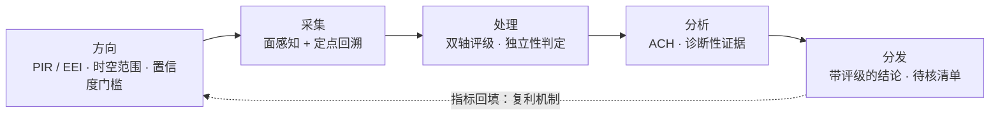
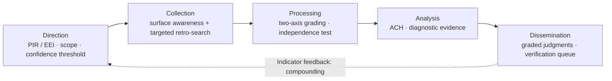

# 信息的动态感知与整合：开源情报技术与情报科学的原理与应用

**中文** ｜ [English](#english)

> **摘要**：开源情报（OSINT）的价值不取决于采集面的宽度，而取决于把未经处理的信息变成可归责判断的那套"度量衡"：需求定义、来源评级、竞争假设检验与校准的概率语言。本文系统梳理这条方法链——从情报循环的需求端出发，经 Admiralty 双轴来源评估、结构化竞争假设分析（ACH），到情报共同体指令（ICD）203 的概率语言规范，再到溯源、时间与地理三个维度的核验技术——并讨论 AI 参与下的精度红线与法律伦理边界。本文的立场是：失效的 OSINT 多死于两个可预防的原因——没有需求定义就开搜，以及把转载当成印证；对应的方法解药在情报科学中早有成文。
>
> **关键词**：开源情报；情报循环；Admiralty 评级；竞争假设分析；估计性概率语言；核验

---

## 1 引言：两个失效模式

公开信息的可得性在持续上升，但"搜到了"与"知道了"之间的鸿沟并没有因此收窄。实践中的失效大多可以归约为两类：

**其一，无靶采集。** 没有事先定义的情报需求（PIR，priority intelligence requirement），采集就退化为无方向的浏览——产出的不是情报，是新闻摘要。需求定义在情报教义中是循环的第一阶段，不是可选的礼貌性步骤[6]。

**其二，评级缺失。** 把转载当成印证是最常见的初级事故：A 媒体引 B 通讯社、B 引 A 的原始报道，在"综合多家媒体报道"的措辞下被计为多个独立来源。来源评估体系存在的意义，正是让每一条信息都携带可追溯的可靠性标定[6][7]。

这两个失效模式规定了本文的叙述顺序：先立需求（§2），再评级（§3），再检验假设（§4），再校准表达（§5），最后才是核验技术（§6）。

## 2 情报循环与需求定义

情报循环的经典表述是四个阶段：**方向（direction）—采集（collection）—处理（processing）—分发（dissemination）**[6]。方向阶段的产物是情报需求及其优先级排序——它回答的不是"搜什么"，而是"为什么搜、搜到什么程度算够、什么算失败"。

两个工程细节值得强调。**第一，需求定义约束的是终止条件**：没有预设的时间窗口与置信度门槛，采集会无限蔓延，最终以"信息疲劳"告终。**第二，循环末端的指标回填是复利所在**：分发阶段产出的预警指标（当前值、触发阈值、触发后果）应在下一循环逐项回填——这使每一次作业成为下一次作业的输入，而非孤立的重复劳动。

## 3 来源评估：双轴评级与独立性判定

现代来源评估的通行框架是 **Admiralty（NATO）体系**[6][7]：对每一条信息分别标定两个维度，且两个维度**在评估时相互隔离**——来源的可靠性不得影响对信息本身的判断。

| 维度 | 记号 | 含义 |
|---|---|---|
| 来源可靠性 | **A–F** | A 完全可靠 → E 不可靠；F 无法判定 |
| 信息可信度 | **1–6** | 1 已被其他独立来源证实 → 5 与现有信息矛盾；6 无法判定 |

三条实操纪律从这里派生：

**一、两轴不得合成。** "B2"（通常可靠的来源、大概为真的信息）是一个结构，不是一个"可信度分数"。合成会掩盖关键的不对称：完全可靠的来源也可能传递失实信息，不可靠的来源偶尔也提供真话。

**二、独立性按末端实源计数。** 转引链上无论隔多少层，独立来源数只按可追溯到的原始信源计算；互引的双方只算一个。这是对抗"转载当印证"的唯一硬规则。

**三、口径冲突并列而不折中。** 当两个可信来源给出互相矛盾的数字（如产量、伤亡），折中平均值不是分析方法——把矛盾如实并列、标注各自评级，矛盾本身就是情报：它提示存在未知的口径差异或事实分歧。

## 4 分析技艺：结构化竞争假设

情报分析的首要敌人不是信息不足，而是认知偏差——确认偏差、镜像思维（以己度人）、后见之明。结构化分析技术（SATs）的立论是：偏差无法靠"更聪明"消除，只能靠**程序化矫正**[2]。

其中最核心的是 Heuer 的**竞争假设分析（ACH）**[1]：把所有合理假设并列，逐条证据逐一检验其与各假设的一致性，最终采信的标准不是"最像真的"的假设，而是**被证伪证据最少**的假设。这个反转是 ACH 的精髓——它把分析者从"为_favorite_假设找证据"的自然倾向，强制扭转为"为每个假设找矛盾"。

配套概念是**诊断性证据**：只有能区分假设的证据才计入矩阵。某条证据与所有假设都相容，它对检验毫无贡献——尽管它可能很有新闻价值。

## 5 置信度与可能性语言

ICD 203[3]确立了两个必须**分离**的表达维度：分析置信度（高/中/低，描述判断的证据基础强弱）与估计性概率（描述事件的估计可能性）。两者不得在同一句话中混用——"我高度置信地认为它不太可能发生"是一个合法陈述，"很可能（高置信度）"则混淆了两个维度。

估计性概率使用校准的七级语言，每级绑定概率区间[3][4]：

| 术语 | 概率区间 |
|---|---|
| 几乎确定（almost certain） | 95–99% |
| 极可能（very likely） | 80–95% |
| 可能（likely） | 55–80% |
| 大致均等（roughly even chance） | 45–55% |
| 不太可能（unlikely） | 20–45% |
| 极不可能（very unlikely） | 05–20% |
| 几乎不可能（almost no chance） | 01–05% |

规范的反面同样重要：**"不排除""或将""存在可能"这类无操作表述应被禁用**——它们不绑定任何区间，因此无法被后续证据证伪或证实，也就无法回填校验。Kent 在六十多年前的告诫至今成立：模糊的词汇不是在表达不确定性，而是在掩盖分析分歧[4][5]。

## 6 核验技术：从溯源到地理定位

评级回答"信多少"，核验回答"是不是"。三个维度的核验构成 OSINT 的技术底座[8][10][11]。

**溯源链。** 对每条关键信息追问五件事：谁首发、何时首发、有无原文链接、是否可独立访问、转述时内容有无变形。溯源的终点应当是可独立访问的原始载体——官方公报、司法文书、一手影像；隔一层转述，评级降一档。

**时间核验。** 影子方位与太阳高度角、植被季节、光线方向都可以对拍摄时间做独立约束。时间核验是识别"旧图翻用"的主要手段——伪造信息最难控制的维度恰恰是时间。

**地理定位。** Bellingcat 式定位的路径是纪律化的线索清单（招牌文字、车牌制式、建筑风格、植被、行车方向）→ 缩小候选区域 → 与卫星影像逐点比对。AI 定位模型已显著进步——PIGEON 在街景图像上可实现全球 25 公里内超过 40% 的命中率[9]——但**精度分布极不均匀**：在地标性窄分布图像上表现优异的模型，对未见过的一般场景泛化能力有限[9]。因此方法论上的红线是：**AI 定位输出一律只作候选区线索，最终定位必须落到可见实体与卫星影像的比对上**。模型可以缩小搜索空间，不能充当证据。

## 7 法律与伦理边界

公开可获取不等于可任意使用。方法链的末端需要三条边界：

**一、个人信息红线。** 以识别、定位真实个人为目的的聚合分析，触及个人信息保护的法律与伦理底线，无论技术是否可行——这条边界属于拒绝执行项，不属于风险权衡项。

**二、操作者安全（OPSEC）。** 采集行为本身会留下痕迹。查询什么、用什么查询、以什么频率查询，都需要与情报需求相匹配的约束；过度采集对操作者与信息来源双方都是暴露。

**三、公开≠授权。** 未加密可访问的信息，其再分发、聚合与商业化仍受著作权、数据保护与平台条款约束。OSINT 的职业纪律之一是区分"我能看到"与"我能使用"。

## 8 结语

本文的方法链——需求定义、双轴评级、竞争假设、概率语言、三维核验——没有一项是新技术；它们全部是情报共同体数十年成文教义的整理[1][2][3][6]。真正的新问题在于：当采集成本趋近于零，失效模式从"找不到"转移为"误判"与"过度采集"，这些旧教义反而成为最稀缺的资源。度量衡先行，工具在后——这是开源情报从"搜资料"走向"情报"的唯一路径。

---

## 参考文献

1. HEUER R J. Psychology of intelligence analysis[M]. Reston, VA: Central Intelligence Agency, Center for the Study of Intelligence, 1999.
2. HEUER R J, PHERSON R H. Structured analytic techniques for intelligence analysis[M]. 3rd ed. Thousand Oaks, CA: CQ Press, 2019.
3. OFFICE OF THE DIRECTOR OF NATIONAL INTELLIGENCE. Intelligence Community Directive 203: analytic standards[S]. Washington, DC: ODNI, 2007 (revised 2015-01-02).
4. KENT S. Words of estimative probability[J]. Studies in Intelligence, 1964, 8(4).
5. KENT S. Strategic intelligence for American world policy[M]. Princeton: Princeton University Press, 1949.
6. UK MINISTRY OF DEFENCE. JDP 2-00: intelligence, counter-intelligence and security support to joint operations[S/OL]. Shrivenham: Development, Concepts and Doctrine Centre, 2023.
7. US DEPARTMENT OF THE ARMY. FM 2-22.3: human intelligence collector operations[S]. Washington, DC: Headquarters, Department of the Army, 2006.
8. NATO. NATO open source intelligence handbook[S/OL]. Version 1.2, 2002.
9. HAAS L, SKRETA M, ALBERTI S, et al. PIGEON: predicting image geolocations[C]//Proceedings of the IEEE/CVF Conference on Computer Vision and Pattern Recognition (CVPR). Seattle: IEEE, 2024: 12893-12902.
10. HIGGINS E. We are Bellingcat: global crime, online sleuths, and the bold future of news[M]. London: Bloomsbury, 2021.
11. HASSAN N A, HIJAZI S. Open source intelligence methods and tools: a practical guide to online intelligence[M]. Cham: Springer, 2018.

---

# Dynamic Perception and Integration of Information: Open-Source Intelligence Techniques and the Principles of Intelligence Science

> **Abstract**: The value of open-source intelligence (OSINT) is set not by the breadth of the collection surface but by the system of measurement that turns unprocessed information into attributable judgment: requirement definition, source grading, competing-hypothesis testing, and calibrated probability language. This paper traces that methodological chain — from the requirement end of the intelligence cycle, through Admiralty two-axis source evaluation and Analysis of Competing Hypotheses (ACH), to the probability lexicon established by Intelligence Community Directive (ICD) 203, and finally to verification technique across three dimensions: provenance, time, and geography. It then discusses the accuracy red lines and legal-ethical boundaries that apply once AI enters the process. The position taken here is that failed OSINT usually dies of two preventable causes: collection begun without a defined requirement, and re-reporting counted as corroboration. Written remedies for both have long existed in intelligence science.
>
> **Keywords**: open-source intelligence; intelligence cycle; Admiralty grading; analysis of competing hypotheses; estimative probability; verification

## 1 Introduction: Two Failure Modes

The availability of public information keeps rising, yet the gap between "found" and "known" has not narrowed accordingly. Failures in practice reduce to two types.

**First, targetless collection.** Absent a defined priority intelligence requirement (PIR), collection degenerates into undirected browsing — what it produces is not intelligence but a news digest. Requirement definition is the first stage of the cycle in intelligence doctrine, not an optional courtesy step [6].

**Second, ungraded reporting.** Treating re-reporting as corroboration is the most common beginner's error: outlet A cites wire service B, B cites A's original story, and under the phrase "multiple media outlets report" the item is counted as several independent sources. The purpose of a source-evaluation system is precisely to make every item carry a traceable reliability marker [6][7].

These two failure modes set the order of what follows: requirement first (§2), then grading (§3), then hypothesis testing (§4), then calibrated expression (§5), and only then verification technique (§6).

## 2 The Intelligence Cycle and Requirement Definition

The classic statement of the intelligence cycle has four stages: **direction — collection — processing — dissemination** [6]. The output of the direction stage is the intelligence requirement and its prioritization; it answers not "what to search" but "why search, how much is enough, and what counts as failure."

Two engineering details deserve emphasis. **First, requirement definition constrains the termination condition**: without a preset time window and a confidence threshold, collection expands without limit and ends in information fatigue. **Second, indicator feedback at the end of the cycle is where compounding lives**: the warning indicators produced at dissemination (current value, trigger threshold, consequence of triggering) should be filled back item by item in the next cycle — which makes each run an input to the next rather than an isolated repetition of labor.

## 3 Source Evaluation: Two-Axis Grading and the Independence Test

The prevailing framework for modern source evaluation is the **Admiralty (NATO) system** [6][7]: two dimensions are marked for every item, and the two are **kept isolated at the moment of assessment** — the reliability of the source must not influence judgment of the information itself.

| Dimension | Notation | Meaning |
|---|---|---|
| Source reliability | **A–F** | A completely reliable → E unreliable; F cannot be judged |
| Information credibility | **1–6** | 1 confirmed by other independent sources → 5 contradicted by existing information; 6 cannot be judged |

Three operating disciplines follow.

**One, the two axes must not be collapsed.** "B2" (usually reliable source, probably true information) is a structure, not a credibility score. Collapsing them hides a crucial asymmetry: a fully reliable source can still pass on false information, and an unreliable source will occasionally tell the truth.

**Two, independence is counted at the terminal real source.** However many layers a citation chain runs through, the count of independent sources is computed only from the original source that can be traced; two parties citing each other count as one. This is the only hard rule against "re-reporting as corroboration."

**Three, conflicting figures are juxtaposed, not averaged.** When two credible sources give contradictory numbers (output, casualties), a midpoint is not an analytic method — set the contradiction out in the open, mark each figure with its grade, and treat the contradiction itself as intelligence: it signals an unknown difference in definition or a genuine factual dispute.

## 4 Analytic Tradecraft: Structured Competing Hypotheses

The primary enemy of intelligence analysis is not insufficient information but cognitive bias — confirmation bias, mirror-imaging, hindsight. The premise of structured analytic techniques (SATs) is that bias cannot be removed by being smarter, only by **procedural correction** [2].

Central among them is Heuer's **Analysis of Competing Hypotheses (ACH)** [1]: set all plausible hypotheses side by side, test each item of evidence against every hypothesis, and adopt not the hypothesis that "sounds truest" but the one **carrying the least disconfirming evidence**. That inversion is the essence of ACH — it forcibly turns the analyst away from the natural inclination to find support for a favourite hypothesis and toward the search for contradiction against every hypothesis.

The companion concept is **diagnostic evidence**: only evidence that discriminates among hypotheses enters the matrix. An item consistent with all hypotheses contributes nothing to the test — however newsworthy it may be.

## 5 Confidence and the Language of Likelihood

ICD 203 [3] establishes two expressive dimensions that **must be separated**: analytic confidence (high / moderate / low, describing the strength of the evidentiary base) and estimative probability (describing the estimated likelihood of an event). The two must not be mixed within one sentence — "I am highly confident that it is unlikely to occur" is a legitimate statement, whereas "likely (high confidence)" conflates the dimensions.

Estimative probability uses a calibrated seven-level lexicon, each level bound to a probability range [3][4]:

| Term | Probability range |
|---|---|
| almost certain | 95–99% |
| very likely | 80–95% |
| likely | 55–80% |
| roughly even chance | 45–55% |
| unlikely | 20–45% |
| very unlikely | 05–20% |
| almost no chance | 01–05% |

The reverse of the norm matters equally: **vacuous formulations such as "cannot be ruled out," "may," and "there exists a possibility" should be prohibited** — they bind no range, so they can neither be confirmed nor disconfirmed by later evidence, and therefore cannot be scored on feedback. Kent's admonition of more than sixty years ago still holds: vague words do not express uncertainty, they conceal analytic disagreement [4][5].

## 6 Verification Technique: From Provenance to Geolocation

Grading answers "how far to believe"; verification answers "whether it is so." Verification along three dimensions forms the technical base of OSINT [8][10][11].

**Provenance chain.** Five questions for every key item: who published first, when, is there a link to the original, is it independently accessible, and has the content been deformed in retelling. The endpoint of provenance should be an independently accessible original carrier — an official gazette, a court document, first-hand imagery; one layer of retelling lowers the grade by one step.

**Temporal verification.** Shadow azimuth and solar elevation, seasonal vegetation, and the direction of light all impose independent constraints on capture time. Temporal verification is the principal means of detecting recycled old imagery — time is precisely the dimension that forged material controls least well.

**Geolocation.** The Bellingcat path is a disciplined checklist of cues (signage lettering, licence-plate format, architectural style, vegetation, direction of traffic) → narrowing the candidate area → point-by-point comparison with satellite imagery. AI geolocation models have improved markedly — PIGEON achieves over 40% accuracy within 25 km worldwide on street-view imagery [9] — but **the accuracy distribution is highly uneven**: models that excel on narrow, landmark-rich distributions generalize poorly to unseen ordinary scenes [9]. The methodological red line is therefore: **AI geolocation output is always a candidate-area cue only, and the final fix must rest on a match between a visible entity and satellite imagery.** A model can narrow the search space; it cannot serve as evidence.

## 7 Legal and Ethical Boundaries

Publicly accessible does not mean freely usable. Three boundaries are needed at the end of the chain.

**One, the personal-data red line.** Aggregated analysis aimed at identifying or locating a real individual touches the legal and ethical floor of personal-data protection, whether or not the technique is feasible — this boundary is a refusal item, not a risk trade-off.

**Two, operational security (OPSEC).** Collection itself leaves traces. What is queried, with what tool, and at what frequency all require constraints matched to the requirement; over-collection exposes both the operator and the sources.

**Three, public does not mean licensed.** For unencrypted, accessible information, redistribution, aggregation, and commercialization remain subject to copyright, data-protection law, and platform terms. One of the professional disciplines of OSINT is distinguishing "I can see it" from "I may use it."

## 8 Conclusion

Not one element of the chain described here — requirement definition, two-axis grading, competing hypotheses, probability language, three-dimensional verification — is a new technology; all of it is a consolidation of decades of written doctrine in the intelligence community [1][2][3][6]. The genuinely new problem is this: when the cost of collection approaches zero, failure modes shift from "cannot find" to "misjudge" and "over-collect," and that old doctrine becomes the scarcest resource. Measurement first, tools after — this is the only path by which open-source work moves from "searching for material" to "intelligence."

---

## References

1. HEUER R J. Psychology of intelligence analysis[M]. Reston, VA: Central Intelligence Agency, Center for the Study of Intelligence, 1999.
2. HEUER R J, PHERSON R H. Structured analytic techniques for intelligence analysis[M]. 3rd ed. Thousand Oaks, CA: CQ Press, 2019.
3. OFFICE OF THE DIRECTOR OF NATIONAL INTELLIGENCE. Intelligence Community Directive 203: analytic standards[S]. Washington, DC: ODNI, 2007 (revised 2015-01-02).
4. KENT S. Words of estimative probability[J]. Studies in Intelligence, 1964, 8(4).
5. KENT S. Strategic intelligence for American world policy[M]. Princeton: Princeton University Press, 1949.
6. UK MINISTRY OF DEFENCE. JDP 2-00: intelligence, counter-intelligence and security support to joint operations[S/OL]. Shrivenham: Development, Concepts and Doctrine Centre, 2023.
7. US DEPARTMENT OF THE ARMY. FM 2-22.3: human intelligence collector operations[S]. Washington, DC: Headquarters, Department of the Army, 2006.
8. NATO. NATO open source intelligence handbook[S/OL]. Version 1.2, 2002.
9. HAAS L, SKRETA M, ALBERTI S, et al. PIGEON: predicting image geolocations[C]//Proceedings of the IEEE/CVF Conference on Computer Vision and Pattern Recognition (CVPR). Seattle: IEEE, 2024: 12893-12902.
10. HIGGINS E. We are Bellingcat: global crime, online sleuths, and the bold future of news[M]. London: Bloomsbury, 2021.
11. HASSAN N A, HIJAZI S. Open source intelligence methods and tools: a practical guide to online intelligence[M]. Cham: Springer, 2018.

---

*The usage tutorial is maintained separately from this paper.*
